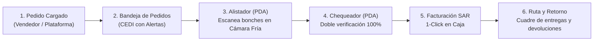

# Plan Maestro: CEDI Sin WhatsApp e Inventario con Identidad Ramificada (WMS Serializado)

> **Estado:** En espera de finalizar puesta al día de CxC (Lucio e Isamara; Guamilito y Occidente ya completados).  
> **Palabra clave para retomar con la IA:** *"Retomemos el plan de `docs/PLAN_CEDI_WMS_SERIALIZADO.md`"*

---

## 1. Objetivo General
Eliminar por completo el envío de pedidos por WhatsApp hacia el CEDI y transformar la operación en un **flujo trazable de extremo a extremo** usando las terminales móviles (PDA / lectores de código de barras), donde cada paquete/bonche físico tenga un **rastro único ramificado** de su código maestro sin duplicar productos en el catálogo.

---

## 2. Arquitectura de Inventario: Identidad Ramificada (Padre $\rightarrow$ Hijos Únicos)

### 2.1. Nivel Padre (Catálogo Maestro — No se duplica)
El producto sigue siendo **un único registro maestro** en `Producto` / `ActivoFijo`:
- **Ejemplo:** Código `010055` | **Rosas Rojas SH** | Stock Total: `100`
- Conserva su precio de venta, costo, categoría, fotos y kardex consolidado.

### 2.2. Nivel Hijo (Unidades / Etiquetas Serializadas — `InventarioUnidad` / `LPN`)
Por cada unidad/bonche físico que ingresa (en `RecepcionLote` o entrada de inventario), el sistema genera una identidad hija única ramificada del código padre:
- **Formato de etiqueta:** `010055-0001`, `010055-0002`, ..., `010055-0100` *(o con lote: `010055-L24-001`)*.
- **Cero fricción en Recepción:** En `encolarImpresionCaja` / `encolarImpresionLoteCompleto` (`src/app/(dashboard)/inventario/recepcion/actions.ts`), el ciclo `for` que hoy imprime $N$ etiquetas iguales imprimirá automáticamente las $N$ etiquetas con su sufijo correlativo único en el código de barras 1D y QR (`src/app/api/impresion/generar-etiqueta/route.tsx`).

### 2.3. Ciclo de Vida (Estados) de cada Etiqueta Hija
Cada etiqueta única pasa por estados estrictos que impiden errores humanos:
1. `DISPONIBLE_BODEGA`: En cámara fría, libre para ser alistado.
2. `ALISTADO_PEDIDO`: Escaneado por el alistador y casado con un `Pedido` específico (nadie más puede tomarlo para otro cliente).
3. `CHEQUEADO_OK`: Verificado por el chequeador en mesa de empaque; listo para facturar.
4. `FACTURADO_EN_RUTA`: Asociado a una `Factura` emitida y despachado con ruta/motorista.
5. `ENTREGADO`: Confirmado con el cliente.
6. `DEVUELTO_BODEGA` / `MERMA`: Escaneado al regreso del camión si no se entregó (reintegrándose al stock si viene en buen estado o pasando a `RegistroMerma` si regresó dañado).

---

## 3. Reglas Operativas Clave con Terminales Móviles (PDA)

1. **¿Cuándo se casa el serial específico con el pedido?**
   - **El Vendedor NO elige seriales:** Al crear el pedido, el vendedor solicita `10 x 010055 (Rosas Rojas SH)`. Eso descuenta `10` del *Stock Disponible para Venta* (como stock comprometido/apartado).
   - **El Alistador casa el serial al escanear:** En cámara fría, el alistador toma *cualquier* bonche disponible de `010055` y al escanear su etiqueta (`010055-0042`), el sistema lo vincula a ese pedido (`1/10`, `2/10`...). Así no pierde tiempo buscando un número de serie específico entre 100 bonches iguales.
2. **Bloqueo de Doble Escaneo:**
   - Si el alistador o chequeador escanea dos veces el mismo bonche (`010055-0042`), la terminal emite alerta sonora/visual: *"Este paquete ya fue escaneado en este pedido"* y no altera la cantidad.
3. **Respeto de Apartados y Pedidos Programados:**
   - Si un bonche ya fue escaneado para un pedido que sale más tarde, y otro operario intenta escanearlo para otro pedido o venta de piso, la terminal lo bloquea indicando a qué pedido y cliente pertenece.
4. **Agrupación Fiscal en Factura SAR:**
   - Al convertir el pedido chequeado en `Factura`, el sistema lee el código padre (`010055`) y agrupa automáticamente los 10 seriales en una sola línea de factura (`10 x ROSAS ROJAS SH`), manteniendo internamente la trazabilidad de cuáles fueron los 10 códigos hijos despachados.

---

## 4. Flujo Paso a Paso: De la Carga del Pedido al Regreso de Ruta

### Fase A: Carga del Pedido y Bandeja Activa (Cero WhatsApp)
- Vendedores cargan pedidos desde el ERP indicando: Cliente, Ruta/Destino, Hora de Despacho (*Inmediato*, *Más tarde / Apartado*, *Recoge en Tienda*) e ítems solicitados.
- **Bandeja de Pedidos CEDI:** Pantalla en tiempo real con **alertas visuales y sonoras** para pedidos nuevos, pedidos próximos a su hora de corte de ruta y pedidos estancados, garantizando que **nunca quede un pedido pendiente olvidado**.

### Fase B: Alistamiento en Cámara Fría (Rol: Alistador)
- Toma el pedido en su terminal móvil.
- Escanea cada bonche físico (`010055-XXXX`).
- Si requiere cambio de variedad/tono por calidad, registra la **Sustitución** directamente en la terminal (usando `sustituidoPorId` en `PedidoItem`).

### Fase C: Chequeo de Salida (Rol: Chequeador)
- Escanea los bonches colocados por el alistador en la mesa de despacho.
- El sistema valida que coincidan al 100% con el pedido (sin faltantes, sin sobrantes y sin productos cruzados).
- Al completar el 100%, el pedido pasa automáticamente a **Listo para Facturar**.

### Fase D: Facturación 1-Click en Caja
- La cajera ve los pedidos en estado **Listo para Facturar** y con un solo clic emite la Factura SAR e imprime el ticket/carta sin tener que digitar productos manualmente.

### Fase E: Despacho de Ruta y Liquidación al Regreso
- Hoja de ruta electrónica por motorista/camión con todos los paquetes (`010055-XXXX`) embarcados.
- Al regresar la ruta, todo paquete devuelto se escanea con la terminal móvil para cuadrar:
  $$\text{Paquetes Despachados} = \text{Paquetes Entregados (Facturas)} + \text{Paquetes Retornados (Bodega / Merma)}$$

---

## 5. Orden de Implementación Técnica (Cuando iniciemos esta fase)

1. **Etapa 1 — Modelo de Datos y Etiquetas Serializadas (`010055-XXXX`):**
   - Crear tabla `InventarioUnidad` (o `EtiquetaSerial`) vinculada a `Producto` / `ActivoFijo`, `RecepcionItem`, `PedidoItem` y `Factura`.
   - Actualizar el generador de etiquetas en Recepción (`encolarImpresionCaja` / `generar-etiqueta`) para emitir los códigos hijos únicos.
2. **Etapa 2 — Bandeja de Pedidos CEDI con Alertas y Reservas de Stock:**
   - Vista de carga de pedidos para vendedores con cálculo de *Stock Físico vs. Stock Apartado vs. Stock Disponible*.
   - Pantalla de Bandeja CEDI en tiempo real con semáforos y alertas sonoras.
3. **Etapa 3 — Modo Terminal Móvil (PDA) para Alistador y Chequeador:**
   - Interfaz optimizada para lector láser con feedback auditivo (*beep* de éxito / *buzzer* de error por doble escaneo, producto incorrecto o paquete ya apartado).
4. **Etapa 4 — Paso directo a Facturación y Cuadre de Rutas:**
   - Botón "Facturar Pedido Chequeado" en Caja y pantalla de "Retorno / Liquidación de Ruta" por escaneo.
